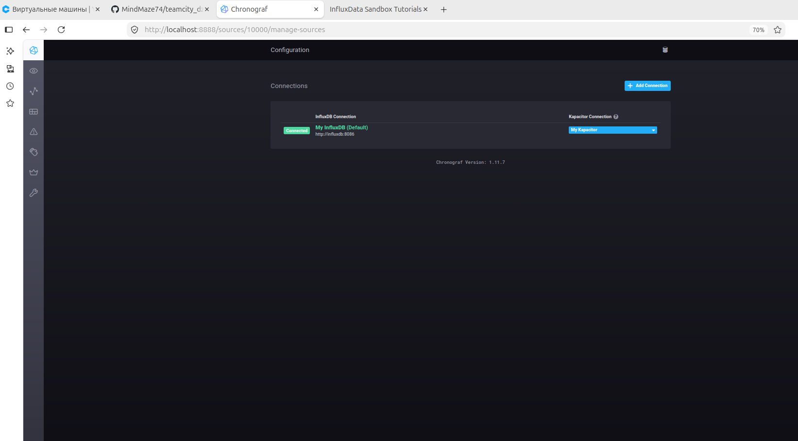
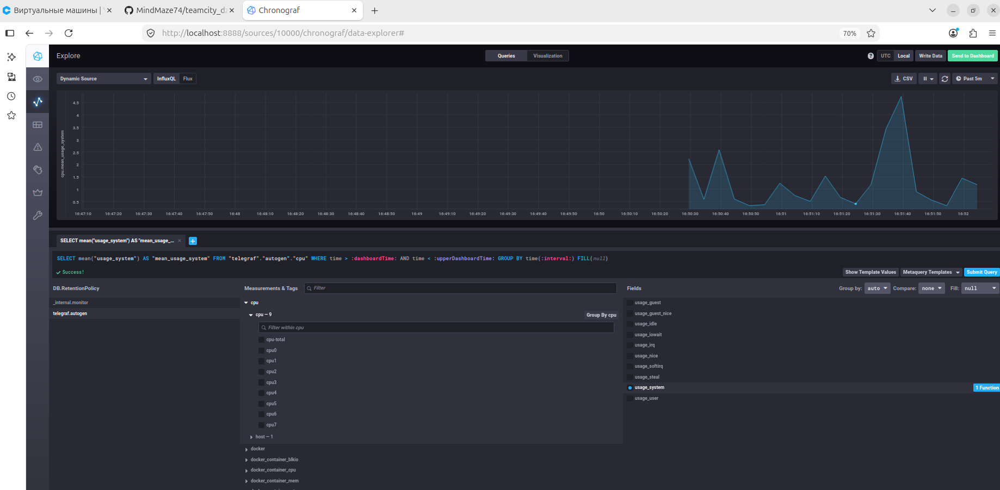
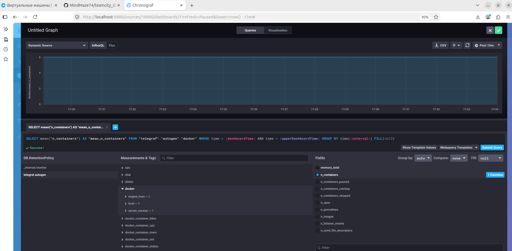
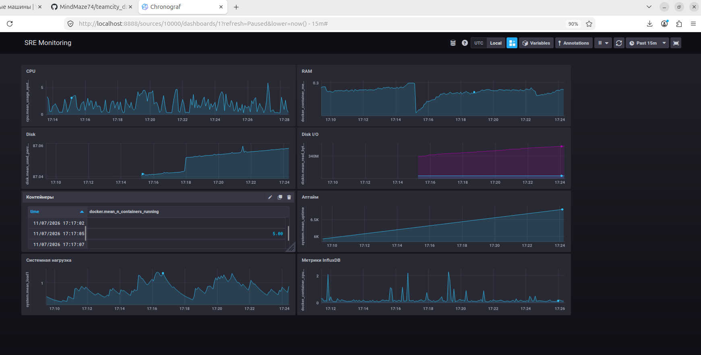

# Домашнее задание к занятию "13.Системы мониторинга" - Старцев Данила Антонович

## Обязательные задания

1. Вас пригласили настроить мониторинг на проект. На онбординге вам рассказали, что проект представляет из себя 
платформу для вычислений с выдачей текстовых отчетов, которые сохраняются на диск. Взаимодействие с платформой 
осуществляется по протоколу http. Также вам отметили, что вычисления загружают ЦПУ. Какой минимальный набор метрик вы
выведите в мониторинг и почему?

Ответ:
Когда меня пригласили настроить мониторинг на платформу, которая выполняет вычисления, генерирует текстовые отчёты и сохраняет их на диск, а взаимодействие идёт по HTTP, я в первую очередь отталкиваюсь от двух вещей: где находятся потенциальные узкие места и что критично для бизнеса. Вычисления грузят CPU - значит, метрики процессора и нагрузки должны быть в основе. Я бы вывел утилизацию CPU по режимам (user, system, iowait), а также load average за 1, 5 и 15 минут, чтобы видеть не только текущую загрузку, но и тренд. Память тоже важна: вычисления могут быть ресурсоёмкими, и риск OOM или деградации из-за свопа вполне реален - поэтому собираю used/available и swap. Раз отчёты сохраняются на диск, я обязательно контролирую свободное место и inodes: текстовые файлы могут быть мелкими и многочисленными, так что inodes - такой же важный ресурс, как и байты. Добавляю метрики дискового I/O (запись, время записи), потому что запись отчётов может стать узким горлышком. Поскольку платформа общается по HTTP, я собираю количество запросов с разбивкой по кодам ответов и гистограмму длительности - это даёт понимание, как быстро обслуживаются клиенты и есть ли ошибки. Сеть (bytes recv/sent, drops) и количество процессов (running, zombie) - вспомогательные, но помогают диагностировать проблемы. В итоге минимальный набор: CPU (usage + load), RAM (used/available/swap), диск (used_percent, inodes_free, diskio_write_*), HTTP (requests_total по кодам, request_duration_seconds) и базовые сетевые метрики. Этого достаточно, чтобы покрыть ключевые риски платформы.

#
2. Менеджер продукта посмотрев на ваши метрики сказал, что ему непонятно что такое RAM/inodes/CPUla. Также он сказал, 
что хочет понимать, насколько мы выполняем свои обязанности перед клиентами и какое качество обслуживания. Что вы 
можете ему предложить?

Ответ:
Менеджеру продукта, который смотрит на мои метрики и говорит, что ему непонятны RAM, inodes и CPUla, я бы объяснил, что эти технические показатели - для инженеров, а для него нужен язык бизнеса. Поэтому я предлагаю перейти на SLI/SLO - индикаторы и цели уровня обслуживания, которые напрямую отражают качество услуг для клиентов. В первую очередь это доступность: доля успешных запросов (без 5xx) от общего числа, с целевым значением, например, 99.9% в месяц. Во вторых, задержка: доля запросов, обслуженных быстрее определённого порога (скажем, 500 мс), или p95/p99 - это то, что клиент реально ощущает. В третьих, успешность выполнения: доля запросов, которые завершились формированием отчёта, а не просто кодом 200. Также можно показать пропускную способность - сколько запросов в минуту мы обрабатываем, и свежесть отчётов - время от запроса до появления файла на диске. Все эти метрики я выведу на отдельный дашборд «Business KPI» в понятном виде: «Доступность 99.95%», «Среднее время ответа 230 мс», «Ошибок 0.01%». Так менеджер будет видеть, насколько мы выполняем обязательства перед клиентами, и сможет принимать решения на основе качества обслуживания, а не технических деталей.
#
3. Вашей DevOps команде в этом году не выделили финансирование на построение системы сбора логов. Разработчики в свою 
очередь хотят видеть все ошибки, которые выдают их приложения. Какое решение вы можете предпринять в этой ситуации, 
чтобы разработчики получали ошибки приложения?

Ответ:
Ситуация, когда DevOps-команде не выделили финансирование на построение системы сбора логов, а разработчикам нужны ошибки приложений, вполне решаема без больших затрат. Я бы предложил несколько вариантов, которые можно внедрить быстро и с минимальными ресурсами. Во-первых, использовать бесплатный тариф Sentry - это специализированный сервис для трекинга ошибок, который даёт разработчикам трейсбеки, группировку, уведомления. Достаточно добавить SDK в приложение, и разработчики получат все ошибки в удобном интерфейсе. Во вторых, можно задействовать уже имеющийся TICK-стек: Telegraf умеет собирать логи через плагин inputs.tail и отправлять их в InfluxDB, а Chronograf позволит визуализировать и искать ошибки. Это не потребует дополнительных затрат, если стек уже развёрнут. В третьих, простой централизованный сбор через rsyslog на существующем сервере с настройкой logrotate - разработчики смогут подключаться по SSH и смотреть логи. В-четвёртых, можно настроить отправку ошибок в Telegram или Slack через webhook: небольшой скрипт парсит лог и шлёт уведомления при появлении ошибок. Наконец, если есть свободные ресурсы, можно поднять open-source решения вроде Graylog Open или Loki + Grafana. Я бы начал с Sentry как самого быстрого и полезного для разработчиков решения, а параллельно настроил logrotate для хранения логов на диске, чтобы ничего не терялось.
#
4. Вы, как опытный SRE, сделали мониторинг, куда вывели отображения выполнения SLA=99% по http кодам ответов. 
Вычисляете этот параметр по следующей формуле: summ_2xx_requests/summ_all_requests. Данный параметр не поднимается выше 
70%, но при этом в вашей системе нет кодов ответа 5xx и 4xx. Где у вас ошибка?

Ответ:
Когда я вижу, что SLA, рассчитанный как summ_2xx_requests / summ_all_requests, не поднимается выше 70%, при этом в системе нет кодов 5xx и 4xx, я сразу понимаю, что в знаменателе учитываются запросы с другими кодами ответов. Скорее всего, это 3xx (редиректы) или 1xx, либо служебные запросы, которые не логируются как HTTP-коды (health-check, WebSocket, оборванные соединения). Если 5xx и 4xx отсутствуют, то по определению SLA должно быть близко к 100%, но 30% запросов имеют какой-то иной код, который не относится к успешным 2xx. Ошибка в том, что формула считает успешными только 2xx, а всё остальное - неуспешным, хотя 3xx не являются ошибкой с точки зрения доступности. Чтобы исправить, я бы пересчитал SLA как (summ_all_requests - summ_5xx_requests) / summ_all_requests - тогда редиректы не будут считаться ошибкой. Либо исключил из знаменателя служебные запросы (health-check, мониторинг). Также я бы добавил метрику с разбивкой по всем кодам ответов (1xx, 2xx, 3xx, 4xx, 5xx) и посмотрел, что именно даёт эти 30% - это поможет точно настроить формулу и понять, откуда берутся запросы с неучтёнными кодами.
#
5. Опишите основные плюсы и минусы pull и push систем мониторинга.

Ответ:
Каждой есть свои сильные и слабые стороны. Pull-модель хороша тем, что конфигурация централизована: сервер мониторинга сам знает, какие цели опрашивать, и если цель не ответила - это сразу сигнал о недоступности. Мы контролируем частоту опроса и не перегружаем цели лишними запросами. Но при этом нужно открывать порты на целевых хостах, а с динамическими средами (контейнеры, автоскейлинг) возникают сложности: требуется service discovery, и новые цели обнаруживаются с задержкой. Кроме того, pull плохо подходит для короткоживущих задач, которые завершаются быстрее, чем их успеют опросить. Push-модель, наоборот, удобна для динамических сред: приложение само отправляет метрики, не нужно открывать порты, работает через NAT. Короткоживущие задачи могут успеть отправить метрики перед завершением. Но здесь сложнее контролировать частоту, возможна потеря метрик при недоступности приёмника, нужно обеспечивать безопасность (аутентификацию), и сложнее обнаружить недоступность цели - для этого нужен dead man's switch. Я обычно выбираю гибридный подход в зависимости от инфраструктуры: для статических серверов - pull, для динамических контейнеров - push.


#
6. Какие из ниже перечисленных систем относятся к push модели, а какие к pull? А может есть гибридные?

    - Prometheus 
    - TICK
    - Zabbix
    - VictoriaMetrics
    - Nagios

Ответ:
Разбираясь с конкретными системами, я отношу их к моделям так. Prometheus - классический представитель pull-модели: он сам опрашивает цели по HTTP. Но у него есть Pushgateway для push-сценариев, так что это скорее гибрид с доминирующим pull. TICK-стек (Telegraf, InfluxDB, Chronograf, Kapacitor) - это push-модель: Telegraf собирает метрики и отправляет их в InfluxDB. Zabbix - гибрид: пассивные проверки работают по pull, а активные агенты и trapper - по push. VictoriaMetrics - тоже гибрид: поддерживает pull через vmagent и push через remote write, аналогично Prometheus. Nagios - pull-модель: плагины опрашивают цели, и NRPE также работает по pull-схеме. Таким образом, чистых pull-систем среди перечисленных - Prometheus (с оговоркой) и Nagios; чистый push - TICK; гибриды - Zabbix и VictoriaMetrics.
#
7. Склонируйте себе [репозиторий](https://github.com/influxdata/sandbox/tree/master) и запустите TICK-стэк, 
используя технологии docker и docker-compose.

В виде решения на это упражнение приведите скриншот веб-интерфейса ПО chronograf (`http://localhost:8888`).



P.S.: если при запуске некоторые контейнеры будут падать с ошибкой - проставьте им режим `Z`, например
`./data:/var/lib:Z`
#
8. Перейдите в веб-интерфейс Chronograf (http://localhost:8888) и откройте вкладку Data explorer.
        
    - Нажмите на кнопку Add a query
    - Изучите вывод интерфейса и выберите БД telegraf.autogen
    - В `measurments` выберите cpu->host->telegraf-getting-started, а в `fields` выберите usage_system. Внизу появится график утилизации cpu.
    - Вверху вы можете увидеть запрос, аналогичный SQL-синтаксису. Поэкспериментируйте с запросом, попробуйте изменить группировку и интервал наблюдений.

Для выполнения задания приведите скриншот с отображением метрик утилизации cpu из веб-интерфейса.



#
9. Изучите список [telegraf inputs](https://github.com/influxdata/telegraf/tree/master/plugins/inputs). 
Добавьте в конфигурацию telegraf следующий плагин - [docker](https://github.com/influxdata/telegraf/tree/master/plugins/inputs/docker):
```
[[inputs.docker]]
  endpoint = "unix:///var/run/docker.sock"

```
Дополнительно вам может потребоваться донастройка контейнера telegraf в `docker-compose.yml` дополнительного volume и 
режима privileged:
```
  telegraf:
    image: telegraf:1.4.0
    privileged: true
    volumes:
      - ./etc/telegraf.conf:/etc/telegraf/telegraf.conf:Z
      - /var/run/docker.sock:/var/run/docker.sock:Z
    links:
      - influxdb
    ports:
      - "8092:8092/udp"
      - "8094:8094"
      - "8125:8125/udp"
```

После настройке перезапустите telegraf, обновите веб интерфейс и приведите скриншотом список `measurments` в 
веб-интерфейсе базы telegraf.autogen . Там должны появиться метрики, связанные с docker.

```





